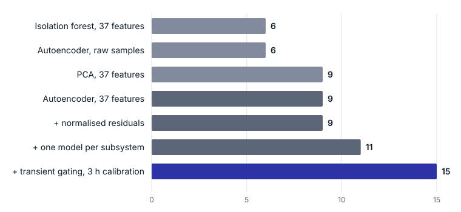

---
# ─────────────────────────────────────────────────────────────────────
# FRONTMATTER: everything between the two dashed lines (top and bottom).
# Lines starting with # are notes for you; the site ignores them.
# Fields marked (required) must be filled or the build stops with an
# error that names the field.
# ─────────────────────────────────────────────────────────────────────

# (required) Full title, shown as the page heading.
title: "Feature-based grouped autoencoders for low-cost fault detection on rotating machinery"

# (required) Must equal the folder name. A draft folder starts with "_".
# To publish: rename the folder to "anomaly-autoencoder", change this to
# "anomaly-autoencoder" and set draft: false (bottom of this block).
slug: "_anomaly-autoencoder"

# (required) Short title for the breadcrumb and browser tab, max 40 characters.
short: "Low-cost autoencoder fault detection"

# (required) One of: efficiency | reproduction | record
type: efficiency

# (required) Must match a discipline page: systems-engineering,
# process-optimization, development, data-analytics, decision-making, consulting
discipline: data-analytics

# (required) Date of first publication, YYYY-MM-DD.
date: 2026-10-28

# (required) Whole number. Raise it when you publish a corrected version.
version: 1

# (required) A list, even for one author.
authors: ["Yannis Fus"]

# (required) Google's description of the page, max 160 characters.
summary: "Four design choices take an autoencoder from 6 to 15 of 15 faults with no false alarms, at 808 times less compute than a raw-sample model."

# (required) One sentence: the finding. Shown on /research/ and in the Key result box.
result: "Grouped autoencoders on 37 engineered features catch all 15 faults (median 36 s, no false alarms) at 1,312 MACs per second, versus 6 of 15 at 1.06 M MACs for a raw-sample autoencoder."

# (optional) Rows of the Key result table. Mark your own method with ours: true.
results:
  - { method: "Autoencoder on raw samples", metric: "Faults caught", value: "6 / 15", cost: "1,060,864 MACs" }
  - { method: "Isolation forest, 37 features", metric: "Faults caught", value: "6 / 15" }
  - { method: "PCA, 37 features", metric: "Faults caught", value: "9 / 15" }
  - { method: "Grouped autoencoders (this paper)", metric: "Faults caught", value: "15 / 15", cost: "1,312 MACs", ours: true }

# (optional) The data the results come from.
benchmark: { name: "Synthetic variable-speed pump station (synther-anomaly-ae simulator)", version: "v1" }

# (optional) Links. Left out here: no preprint yet, code release not decided.
# preprint: "https://arxiv.org/abs/…"
# code: "https://github.com/…"

# (optional) How to rerun everything. Shown in the Reproducibility box.
repro:
  hardware: "2 CPU cores"
  runtime: "Under 15 minutes"
  command: "python experiments.py"

# (optional) Citation text. Readers copy it with one click.
bibtex: |
  @misc{fus2026anomaly,
    title  = {Feature-based grouped autoencoders for low-cost fault detection on rotating machinery},
    author = {Fus, Yannis},
    year   = {2026},
    note   = {Synther Research, draft}
  }

# (optional) One line per version, newest first.
changelog:
  - { version: 1, date: 2026-10-28, note: "First draft" }

# Drafts appear only on your own machine (npm run dev), never on synther.eu.
draft: true
---

## Introduction

Autoencoders are a common choice for unsupervised fault detection on machines: train on normal operation, then alarm when reconstruction error rises. Applied directly to raw sensor samples, they are expensive and, as we show here, not very good at it.

We study what actually improves an autoencoder detector on a variable-speed pump station with 15 gradually developing faults. Four choices matter, and none of them is a larger network:

1. Engineered features instead of raw samples
2. Residuals scored in units of their own noise
3. One small model per physical subsystem
4. Gating during speed transients, with calibration data that covers the operating envelope

Together they raise detection from 6 to 15 of 15 faults, with no false alarms in 3.25 hours of normal operation. They also cut model arithmetic by a factor of 808.

## Benchmark

The test bench is a simulated centrifugal pump station. Because it is simulated, the true onset of every fault is known to the second. This is also the main limitation of the study (see Limitations).

| Signal | Rate | Normal behaviour |
| --- | --- | --- |
| Vibration, drive end and non-drive end | 1 kHz | Shaft orders (1×, 2×, 6× vane pass), a 380 Hz structural resonance and noise; amplitude grows with speed |
| Speed | 10 Hz | Four setpoints from 1,200 to 2,950 rpm, 20 s ramps, held 3 to 15 min |
| Pressure | 10 Hz | Pump affinity law: rises with speed squared, falls as the valve opens |
| Motor current | 10 Hz | Rises with speed cubed and with load |
| Temperature | 10 Hz | Follows current with a 10-minute thermal lag |

An unmeasured valve wanders slowly, so the same speed produces a range of pressures and currents. That defeats fixed limits on single signals.

Five fault types, three of each, are spread over a 6-hour test stream. Each ramps up from zero, so detection delay is meaningful:

| Fault | What changes | Onset ramp |
| --- | --- | --- |
| Bearing outer race | Impacts at 3.57 × shaft speed exciting a 300 Hz resonance | 5 min |
| Imbalance | 1× vibration grows to twice its normal level | 2 min |
| Cavitation | Broadband vibration above 200 Hz; pressure becomes noisy and drops 5 % | 20 s |
| Clogged impeller | Current rises 8 % while pressure stays normal | 1 min |
| Pressure sensor drift | Reading rises by 0.4 bar; nothing physical changes | 5 min |

**Protocol.** All detectors train on 8 hours of normal operation. Each threshold is set 5 % above the highest value its alarm statistic reaches on 3 further hours of normal data. A fault counts as detected when an alarm fires during it. Delay runs from the true onset to the end of the first alarming window. False alarms are alarm starts during 3.25 hours of normal test operation, excluding one minute after each repaired fault.

## Method

**Features.** Each 1-second window is reduced to 37 engineered features: shaft-order amplitudes, band energies and a bearing envelope for the two vibration channels (32 features), plus window means of the process signals. The raw-sample baseline sees 2,040 values per window instead.

**Normalised residuals.** Squared error weighs every feature equally, so 32 noisy vibration features drown 3 precise process ones. Each residual is therefore divided by its spread $\sigma_i$ on normal data:

$$
r_i = \frac{x_i - \hat{x}_i}{\sigma_i}
$$

and the window score is built from the squared $r_i$.

**Grouped models.** The vibration features and the process signals each get their own autoencoder. The process model has 3 inputs and a 2-unit bottleneck, matching the two degrees of freedom that drive normal operation: speed and valve opening. A broken relationship between pressure, current and speed then has nowhere to hide.

**Transient gating.** Averaged over a window in which the speed is changing, pressure and current do not follow the steady-state laws. The process model is therefore held while the speed changes and for 30 s afterwards.

**Smoothing.** The alarm statistic is an exponentially weighted moving average of the log score $s_t$, with weight $\lambda = 0.3$:

$$
S_t = \lambda \log s_t + (1 - \lambda)\, S_{t-1}
$$

## Results

Representation matters more than the model. On raw samples the autoencoder spends its capacity reproducing waveform phase, which says nothing about health. It catches 6 faults, the same as an isolation forest, and fewer than PCA on engineered features (9).

The single 37-feature autoencoder catches every vibration fault and none of the process faults. Clog and drift change no single signal beyond its normal range; they break a relationship between signals. The table compares it with the final detector:

| Fault | Single autoencoder, 37 features | Final grouped detector |
| --- | --- | --- |
| Cavitation | 3 of 3, median 16 s | 3 of 3, median 16 s |
| Pressure sensor drift | 0 of 3 | 3 of 3, median 36 s |
| Clogged impeller | 0 of 3 | 3 of 3, median 21 s |
| Imbalance | 3 of 3, median 78 s | 3 of 3, median 54 s |
| Bearing outer race | 3 of 3, median 114 s | 3 of 3, median 137 s |

Normalised residuals leave detection at 9 of 15 but cut the median delay from 78 s to 56 s. Grouped models take it to 11. The last four faults need the operating-state fix, and the calibration amount turns out to matter as much as the gating:

| Calibration data | Process model during ramps | Faults caught | Median delay | False alarms |
| --- | --- | --- | --- | --- |
| 3 h | held | 15 | 36 s | 0 |
| 3 h | active | 11 | 58 s | 0 |
| 1 h | held | 15 | 15 s | 62 |
| 1 h | active | 15 | 54 s | 13 |

Gating lets the threshold fall to where clog and drift show. That lower threshold is only safe if calibration has seen the whole envelope: one hour of data rarely visited the extreme valve positions, and the gated model fired 62 times at operating points that were normal but unfamiliar.

**Severity at first alarm.** Faults ramp from zero, so the useful measure of reaction is how far a fault has developed when the alarm fires:

| Fault | Onset ramp | Median first alarm | Severity at first alarm |
| --- | --- | --- | --- |
| Pressure sensor drift | 300 s | 36 s | 12 % (0.05 bar) |
| Clogged impeller | 60 s | 21 s | 35 % |
| Imbalance | 120 s | 54 s | 45 % |
| Bearing outer race | 300 s | 137 s | 46 % |
| Cavitation | 20 s | 16 s | 80 % |

The sensor drift is caught at a bias of about 0.05 bar, under 1 % of the pressure range and less than twice the 0.03 bar noise of a single reading.

## Cost

The feature route uses 808 times less model arithmetic than the raw-sample autoencoder and trains in 4.8 s instead of 98.9 s. The vibration model can be shrunk well below its starting size:

| Vibration model layers | MACs, both models | Parameters | Faults caught | False alarms |
| --- | --- | --- | --- | --- |
| 32-64-16-64-32 | 6,304 | 6,517 | 15 | 2 |
| 32-32-8-32-32 | 2,720 | 2,861 | 15 | 1 |
| 32-16-4-16-32 (chosen) | 1,312 | 1,417 | 15 | 0 |
| 32-8-3-8-32 | 720 | 808 | 15 | 0 |
| 32-4-2-4-32 | 432 | 511 | 15 | 0 |

The largest model is the only one with false alarms: a wide bottleneck learns to reproduce unusual inputs too, so its threshold must sit higher.

Quantisation has to follow the signal being protected. With int8 weights for the vibration model and int16 for the process model, the detector fits in 1,614 bytes and still catches 15 of 15 (median 38 s, no false alarms). Int8 everywhere drops to 13 of 15, because the process model must resolve 0.03 bar of noise on a 6 bar range.

At the edge, the 37 features are 148 bytes per second against 8,160 for the raw signals, 55 times less data leaving the machine.

## Limitations

- **Synthetic data.** All results come from a simulator whose fault models we wrote. They show which design choices matter, not how the detector performs on a real machine. A run on a public benchmark is needed before these numbers can be compared with published work.
- **No published baselines.** The baselines (isolation forest, PCA, raw-sample autoencoder) were implemented and run by us on the same data, not taken from the literature.
- **One untraced anomaly.** Overlapping 1-second windows with a 0.5 s hop raised 8 false alarms, against none for non-overlapping windows. The cause has not yet been found.

## Reproducing the results

The code is plain Python (NumPy, SciPy, pandas, scikit-learn) with no deep-learning framework, so every multiply-accumulate is visible. `simulate.py` builds the data: 8 h training, 3 h calibration and 6 h test. `experiments.py` reproduces every number in this paper in under 15 minutes on two cores.
