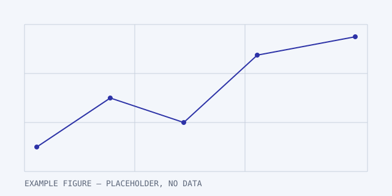

EXAMPLE body. This file is the placeholder the Research pipeline is
developed against: it is a draft, so it is built in development only and
never published, and every value in it is the literal word EXAMPLE.

## EXAMPLE method

EXAMPLE text describing a method that does not exist. A paragraph, then a
list, because the paper page has to render both:

- EXAMPLE bullet one
- EXAMPLE bullet two
- EXAMPLE bullet three

An inline formula, $E = mc^2$, and a block one:

$$
R = \sum_{i=1}^{n} \frac{x_i}{\bar{x}}
$$

## EXAMPLE results

EXAMPLE results table:

| Method | Metric | Value | Cost |
| --- | --- | --- | --- |
| EXAMPLE method A | EXAMPLE metric | EXAMPLE value A | EXAMPLE cost A |
| EXAMPLE method B | EXAMPLE metric | EXAMPLE value B | EXAMPLE cost B |

## EXAMPLE reproduction

EXAMPLE figure with a caption:



EXAMPLE code block:

```bash
EXAMPLE command
```

EXAMPLE text after the figure.
